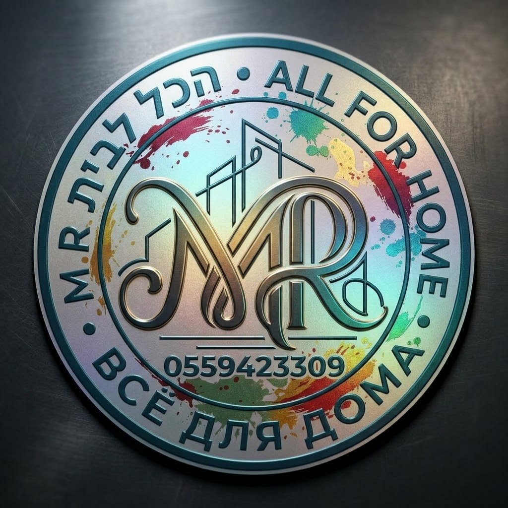

<!DOCTYPE html>
<html lang="he" dir="rtl">
<head>
    <meta charset="UTF-8">
    <meta name="viewport" content="width=device-width, initial-scale=1.0">
    <title>עמוד עסק וביקורות</title>

    <!-- Firebase SDKs -->
    
    

    
</head>
<body>

    <!-- ראש העמוד - לוגו וחתימה -->
    

        
        
    

    <!-- כרטיס ביקור עם הדמות -->
    

        
        

            <h1>שם העסק / דמות</h1>
            
תיאור קצר או מועדון חברים

        

    

    <!-- רשתות חברתיות -->
    

        <a href="#" class="social-btn instagram-btn">אינסטגרם</a>
        <a href="#" class="social-btn tiktok-btn">טיקטוק</a>
        <a href="#" class="social-btn whatsapp-btn">וואטסאפ</a>
    

    <!-- סקציית תגובות וביקורות -->
    

        <h2>הוסף ביקורת</h2>
        

            <label for="reviewer-name">שם מלא:</label>
            <input type="text" id="reviewer-name" placeholder="הכנס את שמך">
        

        

            <label>דירוג:</label>
            

                &#9733;
                &#9733;
                &#9733;
                &#9733;
                &#9733;
            

        

        

            <label for="review-text">חוות דעת:</label>
            <textarea id="review-text" rows="3" placeholder="כתוב את חוות הדעת שלך..."></textarea>
        

        

            <label for="review-file">העלאת תמונה:</label>
            <input type="file" id="review-file" accept="image/*">
        

        <!-- רשימת ביקורות לדוגמה -->
        

            

                

                    ישראל ישראלי
                    ★★★★★
                

                
שירות מעולה וחוויה נהדרת!

                
            

        

    

    <footer>
        
&copy; כל הזכויות שמורות

    </footer>

</body>
</html>

